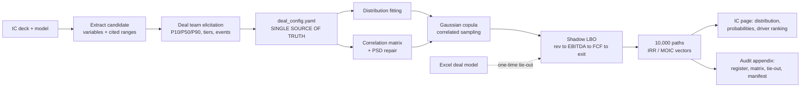

# Monte Carlo Underwriting Agent — Standard Framework & Workflow Plan

*FP AI Summer Challenge, Team 13. Builds on Chris's idea write-up.*

**Design constraint driving every choice below:** the whole thing has to be walkable end-to-end in a 5-minute video. That means one config file, one command, one output pack, and no live document-parsing on the critical path.

---

## 0. The one-line spine

```
IC materials → variable register → distributions → correlation structure
→ driver sheet → shadow LBO → 10,000 paths → IC page + audit appendix
```

Everything in this doc is a standard for one of those seven boxes.



---

## 1. Variable framework: what gets flexed, and how it is described

### 1.1 The fixed taxonomy

Every deal starts from the same six families so no two associates produce differently-shaped models. Target **8 to 12 live variables**, hard cap 15. More than that and nothing is explainable at IC and the correlation elicitation becomes unmanageable.

| # | Family | Typical members | Usually |
|---|--------|-----------------|---------|
| 1 | Market / macro | market growth, price environment, FX, rate path | Market-driven |
| 2 | Revenue build | new logos / volume, ARPU or price, gross churn, net expansion | Mixed |
| 3 | Margin & cost | gross margin, S&M efficiency (CAC or magic number), wage inflation, opex leverage | Operational |
| 4 | Cash conversion | capex % of revenue, NWC days, cash taxes, cash interest | Operational |
| 5 | Exit & structure | exit multiple, exit timing, leverage / paydown, M&A contribution | Market-driven |
| 6 | Discrete events | regulatory approval, top-customer renewal, key contract win, litigation, integration failure, key-person departure | Binary |

The market vs. operational split matters beyond taxonomy: it is the first-pass correlation prior (market variables tend to co-move with each other and with the exit multiple, operational ones tend not to), and it is the split IC actually thinks in ("how much of this is us and how much is the tape").

### 1.2 The variable card (standard record)

Every variable is one record with the same eleven fields. This record is what makes the whole thing auditable, because the register in the appendix is just this table printed.

```yaml
- id: exit_multiple
  name: Exit EV/EBITDA multiple
  family: exit_structure
  unit: x
  type: continuous            # continuous | discrete | binary
  elicitation: [9.0, 11.0, 13.5]   # P10 / P50 / P90, NOT min/base/max
  distribution: lognormal     # auto-suggested, team can override
  bounds: [6.0, 18.0]         # hard floor/cap, always explicit
  source: "IC deck p.34 comps table; entry at 11.0x"
  drives: "Exit EV = ExitYr EBITDA x this"
  owner: "Deal VP"
  rationale: "Comp set traded 9-14x over last 3 yrs; entry multiple = P50"
```

Two disciplines are non-negotiable in this record:

- **Elicit P10/P50/P90, never min/base/max.** People are systematically overconfident at the tails, and a "downside case" is almost never a true worst case. Asking "what number are you 90% sure we beat" produces materially wider and more honest ranges. This one change is probably the single largest accuracy improvement in the whole build
- **`source` and `drives` are mandatory fields.** No variable enters the model without a citation for where the range came from and a statement of exactly which model line it moves. A blank in either column is a validation error, not a warning

### 1.3 Distribution defaults

The team gives three numbers; the tool picks the family by variable character and shows its choice. Defaults:

| Variable character | Default | Why |
|---|---|---|
| Growth rates, margin deltas, symmetric operational levers | PERT (scaled beta) fitted to P10/P50/P90 | Bounded, smooth, respects the base case as mode |
| Multiples, ARPU, anything strictly positive and right-skewed | Lognormal | No negative draws, fat right tail is realistic |
| Churn, retention, utilisation (bounded 0-1) | Beta | Cannot escape [0,1] |
| Exit timing | Discrete PMF, e.g. {4yr: 25%, 5yr: 45%, 6yr: 20%, 7yr: 10%} | Exit year is genuinely lumpy, not continuous |
| Binary events | Bernoulli(p) plus a conditional impact block | See below |
| Anything the team has no view on | Uniform across the range | Honest about ignorance, and visibly so |

Rule enforced by the tool: **no unbounded distribution on a bounded quantity**. Gross margin does not get a normal that can draw 115%.

### 1.4 Binary events

Binary events are where this beats a tornado chart most visibly, so make them first-class:

```yaml
- id: reg_approval
  type: binary
  p_success: 0.75
  source: "Counsel memo 6/12; two comparable approvals in 18mo"
  on_failure:
    revenue_growth: {shift: -6.0, unit: pp}   # additive shift to the draw
    exit_multiple:  {shift: -1.5, unit: x}
    exit_timing:    {shift: +1,   unit: yr}
```

The failure branch shifts other variables' draws rather than being a separate scenario. That is what makes a binary event *correlated* with the continuous variables instead of a bolt-on.

---

## 2. Correlation framework

### 2.1 Solve most of it structurally, not with a matrix

Before eliciting a single correlation number, push relationships into the model logic where a real causal chain exists. Structural linkage is far more defensible at IC than an asserted coefficient:

- Exit multiple should be partly a **function** of terminal growth and terminal margin (e.g. a regression-style relationship off the comp set) plus a residual noise term, not a free-floating variable that happens to correlate 0.6 with growth
- Cash interest is a function of the drawn debt balance and the rate path, not an independent draw
- NWC is a function of revenue, not independent

Then the correlation matrix only has to carry **residual** co-movement. That shrinks the arbitrary-number surface area a lot, which is the main open risk Chris flagged.

### 2.2 The tier ladder

For the residual pairs, translate plain language on a fixed, visible ladder. Sign is elicited separately from strength, because teams reliably know direction and unreliably know magnitude.

| Team says | ρ used | Boundary test at |
|---|---|---|
| Unrelated | 0.00 | — |
| Loosely related | 0.20 | 0.10 / 0.30 |
| Moderately linked | 0.40 | 0.30 / 0.55 |
| Strongly linked | 0.65 | 0.50 / 0.80 |
| Move together almost 1:1 | 0.85 | 0.75 / 0.95 |

This table is printed on screen and in the appendix, always editable. It is never applied silently.

### 2.3 Only elicit the pairs that matter

Do not ask for a full n×n grid, it is 45+ questions at n=10 and the team will guess. Instead:

1. Tool proposes a **short list of 8 to 12 candidate pairs**, drawn from within-family pairs, the market-family-to-exit-multiple pairs, and anything the IC materials explicitly linked
2. Team confirms, overrides, or deletes each, and can add pairs
3. Everything not on the list is **0 by assertion**, and the appendix says so explicitly

### 2.4 Consistency repair, shown not hidden

Hand-specified matrices are frequently not positive semi-definite. Apply Higham's nearest-PSD algorithm, and **print the adjustment log**: original ρ, adjusted ρ, and max delta. If the repair moves any pair by more than 0.10, flag it to the team as "your stated linkages are internally inconsistent, here is what had to give."

### 2.5 Sensitivity to the mapping (the thing Chris said to prove)

Standard, automatic, every run: re-run the full simulation at each tier's lower and upper boundary values and report the movement in P10 / P50 / P90 IRR and MOIC.

- If P10 IRR moves **less than ~150bps** across the tier band, report point estimates and note the insensitivity
- If it moves more, **report a band, not a point**, and say why

This turns the weakest part of the methodology into a stated, quantified caveat, which is exactly what a finance audience wants to see.

---

## 3. Linkage to revenue / EBITDA / cash flow / LBO returns

### 3.1 Do not rebuild the deal model

The deal team's Excel stays the source of truth for structure. Insert a thin **driver sheet**: ~12 named input cells that the existing model already references. That is the contract between the simulation and the model.

### 3.2 Two modes, use both for different jobs

| | Mode A: Python shadow model | Mode B: drive the real Excel |
|---|---|---|
| Speed | ~10,000 paths in under a second | seconds per path |
| Use for | the simulation | one-time tie-out and spot checks |
| Risk | must be validated to match | none, it *is* the model |

**Recommendation: Mode A for the run, Mode B as the tie-out anchor.** The tie-out is a genuinely strong demo beat: "our engine reproduces your Excel base case IRR to within 8 basis points, here is the line-by-line."

### 3.3 The bridge, stated explicitly

The shadow model is ~15 equations. Writing them down in the spec is what makes the leap from variables to returns auditable rather than a black box:

```
Revenue_t      = Revenue_{t-1} x (1 + org_growth_t) + M&A_contrib_t
                 where org_growth_t = f(volume, price, churn, expansion draws)
GrossProfit_t  = Revenue_t x gross_margin_t
EBITDA_t       = GrossProfit_t - Opex_t
                 Opex_t = Opex_{t-1} x (1 + wage_infl_t) x opex_leverage_t
Capex_t        = Revenue_t x capex_pct_t
DeltaNWC_t     = (Revenue_t - Revenue_{t-1}) x nwc_days_t / 365
CashInterest_t = f(Debt_{t-1}, rate_path_t, margin)
CashTax_t      = max(0, (EBITDA_t - D&A_t - CashInterest_t)) x tax_rate
FCF_t          = EBITDA_t - Capex_t - DeltaNWC_t - CashInterest_t - CashTax_t
Debt_t         = Debt_{t-1} - min(FCF_t x sweep_pct, Debt_{t-1}) + mandatory amort
ExitEV         = EBITDA_{exit_yr} x exit_multiple
ExitEquity     = ExitEV - Debt_{exit_yr} + Cash_{exit_yr}
MOIC           = ExitEquity / EntryEquity
IRR            = solve on the equity cash flow vector incl. interim dividends
```

Validation gate before any results are shown: with all variables set to their P50, the shadow model must reproduce the Excel base case IRR within **10bps** and MOIC within **0.02x**. Fail that and the run aborts with a diff table.

---

## 4. Simulation run protocol

- **N = 10,000.** "Hundreds" undersells it, the math is free. Report convergence: P10/P50/P90 IRR plotted against N, converged when the band moves less than 10bps over the last 2,000 draws
- **Sampling:** Gaussian copula on the repaired correlation matrix, Cholesky decomposition, inverse-CDF transform through each variable's own marginal. Binary events drawn off the same underlying correlated normal via a threshold, so they stay linked to the continuous variables
- **Variance reduction:** Latin hypercube or antithetic variates, so 2,000 paths are as stable as 10,000. Useful in the demo where run time is visible
- **Seed is recorded in the output manifest.** Any run is exactly reproducible from the config plus the seed. This is a bigger deal for IC trust than it sounds
- **Pre-flight guardrails, all must pass:** no negative revenue draws, no margins outside bounds, base-case tie-out passed, PSD repair delta under threshold, zero numerical failures, every variable has a non-blank `source` and `drives`

---

## 5. IC output pack

### 5.1 The one IC slide

Five elements, one page, in this order:

1. **IRR distribution histogram** with P10 / P25 / P50 / P75 / P90 marked, **and the deal team's existing base / bull / bear pinned on as vertical lines.** This is the money visual: it shows the three familiar numbers in their actual context, and typically reveals that "downside" sits around the 25th percentile rather than the tail
2. **Probability table:** P(IRR < 0%), P(IRR < 15%), P(IRR > 25%), P(MOIC ≥ 2.0x), P(MOIC ≥ 3.0x), P(capital loss)
3. **Shape read, one sentence.** Compressed or barbell, with the P90-minus-P10 spread and a skew descriptor. This is the "are we being paid for this shape" line
4. **Top 5 drivers of outcome variance,** ranked by rank-correlation of each input draw to the output IRR. This is the honest replacement for the tornado chart, because everything moved together while it was measured
5. **"What has to happen together":** the mean input profile of the top-decile paths versus the bottom-decile paths, side by side. Most differentiated output in the pack, and the one that changes the IC conversation

### 5.2 The audit appendix, auto-generated every run

| Exhibit | Contents |
|---|---|
| A. Variable register | One row per variable: family, type, distribution, P10/P50/P90, bounds, source citation, model line driven, owner |
| B. Correlation pack | Matrix heatmap, the tier→number ladder, elicited-pairs list, the "everything else is zero" statement, PSD repair log |
| C. Tie-out | Shadow model vs. Excel base case, line by line, with deltas |
| D. Robustness | Results at correlation tier boundaries, at ±20% on the three widest ranges, and the N-convergence chart |
| E. Run manifest | Timestamp, seed, N, config file hash, source-model file hash, who signed off on each variable |

Exhibits A, B and E are printed straight from the config, so they cannot drift from what was actually run.

---

## 6. Stress-testing and audit protocol

**The config is the deliverable.** `deal_config.yaml` is committed alongside the deck. Any IC question is answered by editing one field and re-running, which takes under 60 seconds. The design goal is that the associate can answer a partner's challenge *live in the room*.

| IC challenge | Answer, and where it comes from |
|---|---|
| "Where did that range come from?" | Register, `source` column, cites the deck page or memo |
| "Why 0.65 and not 0.9?" | Tier ladder plus Exhibit D boundary test showing how little (or how much) it matters |
| "You're assuming too much correlation" | Re-run with all ρ = 0, show the delta live. Usually narrows the tails |
| "What if the regulatory approval fails?" | Filter the existing 10,000 paths to the failure branch, show the conditional distribution. No re-run needed |
| "Our downside is worse than that" | Widen the P10 on the relevant variable, re-run, show the new shape |
| "Does this tie to the actual model?" | Exhibit C |
| "Could you have got any answer you wanted?" | Exhibit D robustness plus the fixed tier ladder plus the seed |

---

## 7. Five-minute demo script

Anonymised real past deal, config pre-built, extraction pre-cached, tie-out pre-validated. Everything below runs live except the document extraction.

| Time | Beat | On screen |
|---|---|---|
| 0:00–0:30 | The problem | Three dots on an axis, then the same axis with a full distribution behind them. "IC gets three points. This is the shape they actually live in" |
| 0:30–1:10 | Ingest | Point at the IC deck, get back a draft variable register with page citations. State clearly: AI proposed candidates, the team decides |
| 1:10–2:10 | Elicitation | Edit three things live: widen one P10/P90, set one linkage from "moderate" to "strong" and show 0.40 become 0.65 on screen, add the binary regulatory event with its failure branch |
| 2:10–2:35 | Tie-out | Shadow model vs. Excel base case, 8bps apart. "We didn't rebuild your model, we reproduced it" |
| 2:35–3:05 | Run | 10,000 paths in about a second. Distribution appears with base/bull/bear pinned on it. Point out where "downside" actually sits |
| 3:05–3:50 | The IC page | Probability table, driver ranking, then the top-decile vs. bottom-decile input profile. "This is what has to go right together" |
| 3:50–4:35 | Live stress test | Partner voice asks "what if approval fails" → filter to that branch, distribution shifts on screen. Then "what if we assumed no correlation" → re-run, tails narrow visibly |
| 4:35–5:00 | Output | Excel pack plus the IC slide land in the folder. Show the audit appendix scrolling past. Close on the config file: "this is the whole audit trail, it ships with the deck" |

Beats 3:50–4:35 and 2:10–2:35 are the two that win it. The live stress test proves it is a tool and not a chart, and the tie-out kills the "black box" objection before anyone raises it.

---

## 8. Build plan (3 builders, ~1 week alongside day jobs)

**Day 1 is a schema freeze, not coding.** Two contracts get fixed before anyone writes engine code, which is what lets three people work without colliding:

1. `deal_config.yaml` schema (variables, correlations, events, model params)
2. `results.json` schema (path-level IRR/MOIC vectors, input draws, diagnostics)

| Lane | Owner | Scope |
|---|---|---|
| **A. Engine** | strongest Python | Distribution fitting, copula sampling, PSD repair, shadow LBO, convergence, variance reduction |
| **B. Inputs** | | Config schema and validation, structured elicitation flow, IC-document extraction of candidate variables, tier ladder translation |
| **C. Outputs** | | Excel writer, charts, IC slide on the FP branded template, audit appendix generator, run manifest |

| Day | Milestone |
|---|---|
| 1 | Schemas frozen. Deal selected, model obtained, base case tie-out target recorded. Hand-written config for the chosen deal exists |
| 2–3 | Three lanes in parallel against stub data |
| 4 | First end-to-end run on the real config. Tie-out attempted |
| 5 | Tie-out passing. Robustness exhibits (tier boundaries, zero-correlation) generated |
| 6 | Demo rehearsal, timed. Cut anything that does not fit 5 minutes |
| 7 | Record |

**Cut list if behind, in order:** document extraction (hand-enter the config and say so), Mode B Excel driving (tie-out by hand once), pptx generation (screenshot into the slide), variance reduction (just run 10,000 plain).

**Do not cut:** the tie-out, the variable register with sources, the tier-boundary robustness test. Those three are what make it credible to a finance audience, and credibility is the whole thesis of the idea.

---

## 9. Open items to resolve before Day 1

- **Which deal.** Needs one with a genuine binary event correlated to a continuous driver, otherwise the most differentiated capability has nothing to show. This is a logistics dependency, not a technical one
- **Whose base case we tie out to,** and what tolerance the deal team considers a pass
- **Whether the exit multiple gets the structural treatment** (function of terminal growth and margin) or stays a free variable. Structural is more defensible but needs a comp-set relationship, so it may be a v2 item
- **Anonymisation standard** for the demo video, given it will circulate internally
