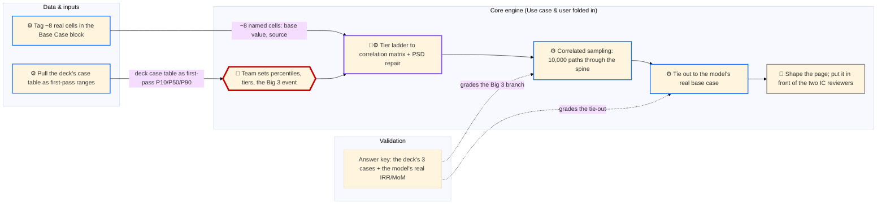

# Build Plan: Monte Carlo Underwriting Agent — Rightway Proof Case

## What's Settled

- **Target system:** Claude Skill — a single, repeatable workflow run per deal, no separate backend or database.
- **Prove first:** the tier-ladder-to-correlation-matrix translation plus the correlated simulation engine, tied out against Rightway's own real base case, tested on the one genuinely tricky case — the Big 3 pricing-response event, which has to move a continuous driver *and* correlate with the exit multiple at the same time.
- **Reuse (don't rebuild):** FP's existing DCF Model Builder skill's Excel case-selector convention for the output page; standard numpy / scipy / pandas / openpyxl inside Claude's own code execution — no new tool or license; the Rightway deck's own rule-of-40-to-multiple rationale (slide 28), fit as a curve rather than re-derived from scratch.
- **People & window:** Emilio, Katrina and Lawrence — three deal associates who work in modeling and IC decks day to day; none currently write Python or use Claude Code as builders. Several days together (Aug 4–6), then async to the Aug 11 demo.
- **Already have:** the real Rightway July 2026 Update IC deck and the real Rightway Model v30.xlsx, both in hand on day one. The deck's own base / upside / downside case table is both the example input and the answer key.

**One thing worth flagging before the lanes below: opening the actual model changed the wiring plan.** Rightway's three cases are not one set of assumption cells flexed by a toggle — they're three separate, fully hardcoded column blocks (Base: columns Q:S, Upside: Z:AB, Downside: AI:AK, in `Opmodel - PBM` and `Opmodel - Nav`), selected by `Summary!AA11` (1/2/3/4). That means tagging happens **inside the Base Case block specifically**, with the case toggle held at 1 throughout every simulated path — not traced through a live flex. This is simpler than the general approach, not harder: the assumption cells inside that block are plain numbers, not formulas.

---

## 1. The Four Lanes

*Color key: 🔴 judgment (thick red, the prove-first step) · 🟣 mixed · 🔵 mechanical · ⚪ manual.*

- **Data & inputs** ships: the tagged cells and the deck's case table, in an agreed shape.
- **Core engine** ships: the thing that runs — the tier-ladder translation, the correlated sampler, the tie-out, and the output page (Use case & user folded in here).
- **Validation** ships: the score, and where it breaks.

**Hand-offs:**
- Data & inputs → Core engine: the ~8 tagged cells, each with its real base value and a slide or model citation, plus the deck's case table as first-pass P10/P50/P90 by slide.
- Core engine (team's own call) → Core engine (the build): the percentiles, linkage tiers, and the Big 3 event definition — the one step that stays entirely the team's judgment, made explicit.
- Core engine → the two IC reviewers: one page — the distribution with the deck's three cases marked on it, the probability table, and the best-decile-versus-worst-decile driver read.
- Validation ↔ Core engine: the answer key (the model's real base/upside/downside IRR and MoM) grades the tie-out on every change, and grades whether the Big 3 branch shifts the right variables in the right direction.

---

## 2. How We'll Know It Works (and How It'll Break)

### What it needs to do

| It needs to… | Mark |
|---|---|
| Turn the team's percentiles and linkage tiers into a valid correlation matrix | EXACT |
| Sample 10,000 correlated paths, including the Big 3 binary event, through the model's real spine | EXACT |
| Reproduce the model's own base-case IRR and MoM within 10bps / 0.02x | EXACT |
| Shift the right variables in the right direction when the Big 3 branch fires | RANGE |
| Cite a source for every variable's range and every correlation number | EXACT |
| Produce a page the two IC reviewers find useful without a walkthrough | RANGE |

| What | "Working" looks like | "Broken" looks like | Where you'd see it | How we check |
|---|---|---|---|---|
| Core engine — tier ladder + sampling | Matrix passes PSD repair with a small adjustment log; P10/P50/P90 stable over the last 2,000 of 10,000 draws | Repair silently moves a stated linkage by more than 0.10; the band still moving at 10,000 | The correlation pack; the convergence chart | Re-run against the fixed tier-ladder table on every change |
| Core engine — the tie-out | IRR within 10bps and MoM within 0.02x of the model's own base case at every variable's P50 | Any spine row diverges from the real model | The tie-out exhibit, row by row | Re-run against the real Rightway model on every change |
| Core engine — the Big 3 branch | New-deal volume, retention, and (via the exit-multiple link) the multiple all move together when the branch fires, in the direction the deck's own risk table implies | Only one variable moves, or the multiple doesn't follow growth and margin down | The worst-decile input profile on the output page | Validation reads the shifted profile against the deck's risk table |
| Data & inputs — the tagged cells | ~8 named cells, each with its real base value and a slide or model citation | A tag that isn't actually inside the Base Case block, or has no source | The variable register | Spot-check every tag against the workbook before Core builds on it |
| Use case & user (folded in) — the page | The two IC reviewers read the shape and the drivers without a walkthrough | They ask what a number means, or ask for the old three-case table back | The review session | A real reaction from the two IC reviewers |
| Whole thing, start to finish | Team's raw percentiles/tiers/event → the page in front of the two IC reviewers, no manual patching | Any step needs a hand-edit to produce the next one | A dry run before the review session | One full run on Rightway, days 1–3; repeated async |

---

## 3. How the Work Divides

| Element of work | Lane | Can start day one on |
|---|---|---|
| Tag the ~8 real assumption cells in the Base Case block and confirm each one's citation | Data & inputs | the attached Rightway model |
| Pull the deck's case table (slide 28) as the first-pass P10/P50/P90 for each variable | Data & inputs | the attached Rightway deck |
| Set the team's own percentiles, linkage tiers, and the Big 3 event definition | Core engine | the deck's case table as a starting point |
| Build the tier-ladder-to-correlation-matrix translation, with the PSD repair log | Core engine | the fixed tier-ladder table |
| Build the correlated sampler and the reduced-form spine, calibrated to the Base Case block | Core engine | the tagged cells, once agreed |
| Run the tie-out against the model's real base case | Core engine | the attached Rightway model |
| Shape the output page and book the review with the two IC reviewers | Core engine (Use case & user folded in) | a mocked-up page, before the engine is proven |
| Write the answer key: the deck's three cases plus the model's real IRR/MoM | Validation | the attached deck and model |
| Grade the tie-out and the Big 3 branch on every change | Validation | the answer key |
| Get the two IC reviewers' real reaction and grade it | Validation | the booked review session |

**Across 3 people:** Core engine, with Use case & user folded in, on its own; Data & inputs on its own; Validation on its own.
**Protected split:** Validation never sits with Core engine.

**A gap worth naming plainly:** none of the three builders write Python or use Claude Code today. That's what the tool is for — Core engine's work happens by directing Claude directly rather than hand-writing the engine, and its hardest day-one skill is reading a tie-out delta and pushing back on what comes back, not syntax. That learning curve is real and deserves more of the in-person time than any single line item below.

---

## 4. Checkpoints — in person, then async

### Days 1–3, in person (Aug 4–6) — get the Core working

- **Day 1 (Aug 4):** agree hand-offs first — the ~8 tagged cells' names, base values and citations, plus the deck's case table as first-pass ranges. Core starts on the tier ladder and sampler immediately against the deck's own numbers; Validation starts the answer key straight off the model's real IRR/MoM; Data & inputs tags the cells.
- **Day 2 (Aug 5):** Core against the answer key — tie-out attempted, graded. This is the narrowing day: if the tie-out won't close, cut which cells get tagged now (drop the Nav-tab granularity, hold opex fixed) while everyone is still in the room.
- **Day 3 (Aug 6):** Core holds the tie-out on the base case; prove the Big 3 branch specifically — the one tricky case. Walk every hand-off out loud, and book the one async sync plus the review slot with the two IC reviewers before anyone disperses.

**If Core isn't holding the tie-out at the end of day 3:** say so plainly — the async half becomes "keep proving Core," not "start wrapping it." Nothing below gets funded until the base case ties out.

### Days 4–8, async (Aug 7–10) — wrap the proven Core

Spent in scoring order:

1. **Core still first.** Keep closing the tie-out and the Big 3 branch if either is still wobbling — that's the work, not a nicer page.
2. **Then elegance.** Re-check the correlation tier-boundary robustness test (does the answer move less than ~150bps across a tier's boundary values). Confirm the tier-ladder mapping is doing the team's own judgment, not quietly become a black box that happens to pass the tie-out.
3. **Then completeness, if time genuinely remains.** The audit appendix, a second past deal as a fresh real case, the archetype-driven opening conversation from the fuller workflow spec — all explicitly last.

**One scheduled sync:** booked before dispersing, placed at the point the two IC reviewers see the real page for the first time — not a status update at the end.

**One-line fallback per lane:**
- Core engine — the tagged cells and the tier ladder are agreed in writing, so the other two lanes keep moving against them even if Core's driver is out for two days.
- Data & inputs — the deck's case table already gives Core a first-pass range, so a delay here doesn't block the tie-out attempt.
- Validation — the answer key is written from the model directly, so grading can happen without the checker present at every run.

**Ship (Aug 11):** demo recorded; the output page and the config file — the audit trail — delivered alongside it.
