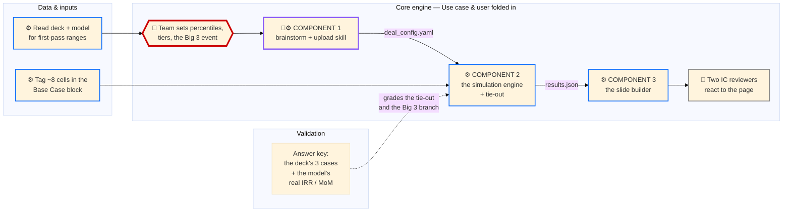

# Build Plan: Monte Carlo Underwriting Agent — Three Components in Claude Code

## What's Settled

- **Target system: a Plugin, not a single Skill.** This changed with the three-component ask. Three pieces that chain — the brainstorm-and-upload conversation, the simulation engine, the slide builder — is the definition of a Plugin: several skills composed, with the hand-offs between them as real files someone has to build. The earlier plan said Skill because it was one workflow; three chained pieces is a different shape.
- **Prove first:** the simulation engine — correlated sampling through the model's real spine, tied out to Rightway's own base case (IRR 20.6% / MoM 2.3x), including the Big 3 pricing event that has to move a continuous driver *and* pull the exit multiple with it. The conversation piece and the slide builder are the wrap around it.
- **Reuse (don't rebuild):** the `fp-ppt-template` skill for the FP-branded deck (the slide builder calls it rather than styling slides from scratch); the `fp-internal-skills:plugin-deployment` skill for publishing to the internal marketplace; `numpy` / `scipy` / `pandas` / `openpyxl` / `python-pptx`, all standard and free; the Rightway deck's own rule-of-40-to-multiple anchors on slide 28, fit as a curve rather than re-derived.
- **People & window:** three deal associates who work in modeling and IC decks day to day; none currently write Python or use Claude Code. Together Aug 4–6, then async to the Aug 11 demo. **Already have:** the real Rightway Update IC deck and Rightway Model v30.xlsx.

**A scope call worth making before day one.** Three components in a week, with three people learning Claude Code as they go, is a genuine stretch. The honest ordering: the **engine is the only prove-first piece**. The conversation piece degrades gracefully — if it isn't ready, the config file gets hand-filled and the demo says so. The slide builder is the 10%-weighted tier and should be funded last; a screenshot of a chart pasted into a deck scores the same as a generated one if the engine holds. Nothing below asks for all three to be finished; it asks for the engine to be *proven* and the other two to be *wrapped around it in that order*.

---

## 1. The Four Lanes



*Color key: 🔴 judgment (thick red, the prove-first step) · 🟣 mixed · 🔵 mechanical · ⚪ manual.*

- **Data & inputs** ships: the tagged cells and the deck's case table, in an agreed shape.
- **Core engine** ships: the thing that runs — all three components, the tie-out, and the review session (Use case & user folded in here).
- **Validation** ships: the score, and where it breaks.

**Hand-offs — and here two of them are files someone has to build, not just agreements:**
- Data & inputs → Core engine: the ~8 tagged cells, each with its real base value and a slide or model citation, plus the deck's case table as first-pass P10/P50/P90.
- Core engine (the team's own call) → Core engine (the build): the percentiles, linkage tiers, and Big 3 event definition — the one step that stays entirely the team's judgment, made explicit.
- **Component 1 → Component 2: `deal_config.yaml`.** A real file. Every variable with its distribution, bounds, source citation, owner, and the correlation tiers. This is the audit trail and it ships with the deck.
- **Component 2 → Component 3: `results.json`.** A real file. The 10,000 paths' IRR and MoM, every input draw, the percentiles, the driver ranking, and the run manifest with the random seed.
- Core engine → the two IC reviewers: one page — the distribution with the deck's three cases marked on it, the probability table, and the best-decile-versus-worst-decile driver read.
- Validation ↔ Core engine: the answer key (the model's real base/upside/downside IRR and MoM) grades the tie-out on every change, and grades whether the Big 3 branch shifts the right variables in the right direction.

**Because this is a Plugin, those two files are the orchestration.** Freeze both on day one, in writing, before anyone builds. They are what let the three components be built in any order and still meet — and they are the piece that ends up un-owned by default, because writing a file format feels like nobody's job.

---

## 2. How We'll Know It Works (and How It'll Break)

### What it needs to do

| It needs to… | Mark |
|---|---|
| Read the deck and the model and write a valid `deal_config.yaml`, every variable carrying a source citation | EXACT |
| Turn the team's linkage tiers into a valid correlation matrix, with the repair log printed | EXACT |
| Sample 10,000 correlated paths, including the Big 3 event, through the model's real spine | EXACT |
| Reproduce the model's own base-case IRR and MoM within 10bps / 0.02x | EXACT |
| Shift the right variables in the right direction when the Big 3 branch fires | RANGE |
| Build the FP-branded page from `results.json` with no hand-editing | EXACT |
| Produce a page the two IC reviewers find useful without a walkthrough | RANGE |

| What | "Working" looks like | "Broken" looks like | Where you'd see it | How we check |
|---|---|---|---|---|
| Component 1 — brainstorm + upload | A config file comes back with every variable sourced to a slide or a model cell, and nothing invented | A variable with a blank source, or a range that isn't in the deck | The config file's source column | Read every row against the deck, days 1–3 |
| Component 2 — the engine | Matrix passes repair with a small adjustment log; percentiles stable over the last 2,000 of 10,000 draws | Repair silently moves a stated linkage by more than 0.10; the band still moving at 10,000 | The correlation pack; the convergence chart | Re-run against the fixed tier ladder on every change |
| Component 2 — the tie-out | IRR within 10bps and MoM within 0.02x of the model's own base case at every variable's P50 | Any spine row diverges from the real model | The tie-out exhibit, row by row | Re-run against the real Rightway model on every change |
| Component 2 — the Big 3 branch | New-deal volume, retention and (through the exit-multiple link) the multiple all move together when the branch fires, in the direction the deck's own risk table implies | Only one variable moves, or the multiple doesn't follow growth and margin down | The worst-decile input profile on the page | Validation reads the shifted profile against the deck's risk table |
| Component 3 — the slide builder | Runs from `results.json` alone and produces the FP-branded page with no hand-editing | Needs a manual fix to the chart or the table before it's presentable | The generated file, opened cold | Run it twice on two different result files |
| Data & inputs — the tagged cells | ~8 named cells, each with its real base value and a citation | A tag that isn't actually inside the Base Case block, or has no source | The variable register | Spot-check every tag against the workbook before the engine builds on it |
| Use case & user (folded in) — the page | The two IC reviewers read the shape and the drivers without a walkthrough | They ask what a number means, or ask for the old three-case table back | The review session | A real reaction from the two IC reviewers |
| Whole thing, start to finish | Conversation → config → engine → results → page, no hand-patching between any two steps | Any step needs a hand-edit to produce the next one | A dry run before the review session | One full run on Rightway, days 1–3; repeated async |

---

## 3. How the Work Divides

| Element of work | Lane | Can start day one on |
|---|---|---|
| Set up the repo, run `/init`, write the CLAUDE.md that tells Claude the house rules | Core engine | an empty folder and the Claude Code docs |
| Write the two file formats — `deal_config.yaml` and `results.json` — and freeze them | Core engine | the variable-card spec in the v04 workplan |
| Tag the ~8 real assumption cells in the Base Case block and confirm each citation | Data & inputs | the attached Rightway model |
| Pull the deck's case table (slide 28) as the first-pass P10/P50/P90 per variable | Data & inputs | the attached Rightway deck |
| Set the team's own percentiles, linkage tiers, and the Big 3 event definition | Core engine | the deck's case table as a starting point |
| Build Component 1: the skill that asks the four questions, reads the uploads, writes the config | Core engine | the frozen config format |
| Build Component 2: the tier-ladder translation and the correlated sampler | Core engine | the fixed tier-ladder table |
| Build Component 2: the reduced-form spine calibrated to the Base Case block | Core engine | the tagged cells, once agreed |
| Run the tie-out against the model's real base case | Core engine | the attached Rightway model |
| Build Component 3: the slide builder on top of the `fp-ppt-template` skill | Core engine | a hand-written sample `results.json` |
| Wire the three components into one plugin folder with a manifest | Core engine | the frozen file formats |
| Shape the page and book the review with the two IC reviewers | Core engine (Use case & user folded in) | a mocked-up page, before the engine is proven |
| Write the answer key: the deck's three cases plus the model's real IRR/MoM | Validation | the attached deck and model |
| Grade the tie-out and the Big 3 branch on every change | Validation | the answer key |
| Read every config row against the deck, hunting invented numbers | Validation | the deck and the first config file |
| Get the two IC reviewers' real reaction and grade it | Validation | the booked review session |

**Across 3 people:** Core engine, with Use case & user folded in, on its own; Data & inputs on its own; Validation on its own.
**Protected split:** Validation never sits with Core engine.

**A gap worth naming plainly:** none of the three builders write Python or use Claude Code today. That is what the tool is for — Core engine's work happens by directing Claude in the terminal rather than hand-writing the engine — but two specific skills have no holder yet and need the in-person days: reading a tie-out delta and pushing back on what comes back, and noticing when Claude has quietly replaced the statistics with rules that happen to pass. Neither is syntax, and neither is learnable async.

---

## 4. Checkpoints — in person, then async

### Days 1–3, in person (Aug 4–6) — get the Core working

**Day 1 (Aug 4) — setup and the two file formats.**

Do the plumbing once, together, so nobody repeats it:

1. One folder, one repo. In the terminal: `claude` in an empty folder, then `/init` to generate the CLAUDE.md.
2. Write the CLAUDE.md by hand, not from a template. Three house rules that matter for this build: never invent a number that isn't in a cited source; every EXACT line gets computed by a script, never worked out in the reply; the Excel workbook is read-only and never written to.
3. The folder shape, which is also the plugin shape:

```
monte-carlo-underwriting/
  .claude-plugin/plugin.json
  skills/brainstorm-deal/SKILL.md       <- Component 1
  skills/build-ic-page/SKILL.md         <- Component 3
  engine/                               <- Component 2
    sample.py  spine.py  tieout.py
  schemas/
    deal_config.schema.yaml
    results.schema.json
  cases/rightway/                       <- the answer key lives here
```

4. **Then the hour that buys the whole week:** write `deal_config.yaml` and `results.json` out by hand for Rightway, fully populated, before either is generated by anything. Those two hand-written files are the hand-offs. Once they exist, all three components can be built against them in any order.

Then every lane starts: Core engine on the tier ladder and sampler against the deck's own numbers; Validation writing the answer key straight off the model's real IRR/MoM; Data & inputs tagging the cells.

**Day 2 (Aug 5) — the engine against the answer key. This is the narrowing day.**

The tie-out gets attempted and graded, repeatedly. Ask Claude for the reduced-form spine one row at a time, not all at once — revenue first, tie it out, then gross profit, then EBITDA less CapCosts, then exit TEV, then FP proceeds at 8.1% fully diluted. A tie-out that fails on row four is diagnosable; one that fails on the IRR is not.

If it won't close by mid-afternoon, cut the slice while everyone is in the room: drop the Nav-tab granularity and hold Nav flat, hold opex at its base-case ratio, and simulate five variables instead of eight. A smaller engine that ties out beats a bigger one that doesn't.

**Day 3 (Aug 6) — the hard case, then the hand-offs out loud.**

The base-case tie-out holds. Now prove the one genuinely tricky thing: the Big 3 branch firing, shifting new-deal volume and retention, and pulling the exit multiple down through the rule-of-40 curve. That is the capability nothing else in the firm has, and it is the demo.

Then: walk both file formats out loud, confirm both sides of each hand-off know what they owe, and book two things before anyone disperses — the one async sync, and the slot with the two IC reviewers.

**If the tie-out isn't holding at the end of day 3:** say so plainly. The async half becomes "keep proving the engine," not "start building slides." Component 3 does not get funded until the base case ties out — a beautiful slide of a distribution that doesn't reconcile to the model is worse than no slide, because it will get shown.

### Days 4–8, async (Aug 7–10) — wrap the proven engine

Spent strictly in scoring order:

1. **The engine still comes first.** If the tie-out or the Big 3 branch is still wobbling, that is the work. Not Component 1, not Component 3.
2. **Then elegance.** Two specific checks. Re-run the correlation tier-boundary test — does the answer move less than about 150bps across a tier's boundary values? And read the engine's own code with fresh eyes for the failure that matters: has the correlated sampling quietly become a lookup table that reproduces the three deck cases and interpolates between them? That would pass every EXACT line and be worthless.
3. **Then Component 1, the conversation.** It is the most demo-visible piece and the least risky, which is exactly why it is tempting to build first and correct to build third. It writes a file whose format is already frozen, so it cannot break anything upstream of it.
4. **Then Component 3, the slide builder,** calling `fp-ppt-template` rather than styling anything itself. If time runs out here, a screenshot pasted into the deck costs almost nothing in scoring.
5. **A real reaction.** The page in front of the two IC reviewers, graded against the answer key by Validation — not by the lane that built the page.

**One scheduled sync:** booked before dispersing, placed where the two IC reviewers see the real page for the first time. Not a status update at the end.

**One-line fallback per lane:**
- Core engine — both file formats are frozen in writing, so the other two lanes keep moving against them even if the engine's driver is out for two days.
- Data & inputs — the deck's case table already gives the engine a first-pass range, so a delay in tagging doesn't block the tie-out attempt.
- Validation — the answer key comes off the model directly, so grading doesn't need the checker present at every run.

**Ship (Aug 11):** demo recorded. Three things delivered alongside it: the generated page, the `deal_config.yaml` that produced it, and the run manifest with the random seed — so any number on the page can be reproduced exactly.

**After the hackathon, if it gets used:** publishing the plugin to the internal marketplace has its own FP-specific route, and the `fp-internal-skills:plugin-deployment` skill covers the versioning and CI that route needs. That is a real step, not a formality, and it is explicitly out of scope before Aug 11.
