# Video Plan: Monte Carlo Underwriting Agent

**Target:** 5:00 · screen recording with voiceover · 4 beats
**The one thing to land:** A real deck and a real model go in; a defensible, fully-sourced distribution of outcomes -- not three guessed points -- comes out, and every number on the page traces back to a citation.

## The workflow -- what's built, what's not

```mermaid
flowchart LR
    A[⚙️ Ingest deck + model] --> B{{🧠 AI proposes<br/>variable card}}
    B --> C[🧑 Team confirms / edits]
    C --> D{{🧠 Extract base-case<br/>financials}}
    D --> E[⚙️ Tie out LBO mechanics]
    E --> F[⚙️ Run 10,000-path<br/>Monte Carlo]
    F --> G[⚙️ Export IC slide]

    style A fill:#fff3cd,stroke:#0d6efd,stroke-width:2px
    style B fill:#d4edda,stroke:#c00,stroke-width:4px
    style C fill:#f1f1f1,stroke:#888,stroke-width:2px
    style D fill:#d4edda,stroke:#c00,stroke-width:4px
    style E fill:#fff3cd,stroke:#0d6efd,stroke-width:2px
    style F fill:#d4edda,stroke:#0d6efd,stroke-width:2px
    style G fill:#d4edda,stroke:#0d6efd,stroke-width:2px
```

*🔴 judgment · 🔵 mechanical · 🧑 human checkpoint, by design -- ✅ proven (B, D, F, G: verified this
week against the real Weave/Project Willow deck and model) · 🔧 built, rough (A: ingestion works but
truncates very large models past ~650k characters, though the priority tabs survived intact on
Weave; E: ties reasonably on IRR but runs MoIC hot -- see the gap beat).*

## The storyboard

| Time | What's showing | What you say | Why this beat exists |
|---|---|---|---|
| 0:00-0:20 | The Weave IC deck, Executive Summary slide, "Base Case IRR / MoM: 22.7% / 2.3x" | "Every deal we bring to IC comes down to three numbers: a base case, an upside, a downside." | Problem, concrete, real deal |
| 0:20-0:45 | Same slide, zoomed to the three-point framing | "Pulling those three points out of a real deck and model by hand takes an associate [confirm: how long], and even then IC is looking at three guesses, not the real shape of what could happen." | States the cost and the gap the tool closes |
| 0:45-1:05 | The app's Ingest screen, the real Willow deck PDF and Weave Model v54.xlsx selected | "This is a real deck and a real model for an actual deal we're evaluating. Everything from here runs against these two files." `[pause]` | Sets up the demo on real input, not a toy |
| 1:05-1:35 | The confirmed variable card -- 9 variables, each with a citation (e.g. market growth sourced to deck slides 12/18/14) | "The model reads the deck and proposes a variable card -- each range cited to a page, not invented. We reviewed and confirmed this one." | The judgment step -- Elegance shows up here |
| 1:35-2:05 | The Stage 5b LBO mechanics screen: entry TEV $646.0M next to the deck's own disclosed TEV; IRR tie 22.3% vs. the deck's 22.7% | "Before we simulate anything, it checks itself against the deal's own numbers. $646 million computed from the offer price and share count -- the deck's own model says $646 million. The IRR ties to within half a point." | The single strongest credibility frame in the video |
| 2:05-2:25 | Clicking Run Monte Carlo; the 10,000-path distribution rendering live | `[silence -- let it run and land]` | The payoff, live, on real data |
| 2:25-2:50 | The driver-ranking table, Exit Multiple at the top (rank correlation 0.87) | "Exit multiple is the single biggest swing factor here -- and that's the model's own read of this deal, not something we told it to say." | Elegance -- judgment, not a hardcoded rule |
| 2:50-3:00 | The exported IC slide, full page | "That whole distribution becomes one IC-ready slide, formatted, sourced, done." | Closes beat 2 on the artifact, not the process |
| 3:00-4:00 | The LBO-mechanics warnings panel; the `engine/` folder showing only TODOs | "Two honest gaps. Our tie-out matches the deck's IRR closely but runs the return a bit hot -- we're using a simplified debt paydown, and it says so on screen. And the fully rigorous, cell-by-cell Excel reproduction we originally scoped isn't built -- what we have is a generic engine, not a bespoke one." | Gap, concrete, already self-disclosed by the tool |
| 4:00-4:30 | The app running locally, one command in a terminal | "Today this runs locally, one deal at a time, from one person's machine, and it depends on that person's own Claude login." | Names the remaining fragility plainly |
| 4:30-5:00 | Back to the exported IC slide | "Once we trust this on more deals, the plan is to put it behind Tines so the whole deal team can run it without installing anything -- and eventually the same engine that does one deal's distribution could screen several at once." | Vision: same core, one step on |

~640 words of script (see below), demo block (0:45-3:00) carrying the real payoff with deliberate
silence at the run, and both the tie-out and the gap shown on the deal's own real numbers.

## The script

**[0:00]** Every deal we bring to IC comes down to three numbers: a base case, an upside, a
downside.

**[0:10]** Pulling those three points out of a real deck and model by hand takes an associate
[confirm: how long -- a day? two?], and even then, IC is looking at three guesses, not the real
shape of what could happen.

**[0:30]** This is a real deck and a real model for an actual deal we're evaluating. Everything
from here runs against these two files. `[pause]`

**[1:05]** The tool reads the deck and proposes a variable card -- each range cited to a page, not
invented. We reviewed this one and confirmed it.

**[1:35]** Before it simulates anything, it checks itself against the deal's own numbers. Six
hundred forty-six million, computed from the offer price and the share count -- the deck's own
model says the same six hundred forty-six million. The IRR ties to within half a point of the
deck's base case.

**[2:05]** `[silence -- let the 10,000 paths run and the distribution land]`

**[2:25]** Exit multiple is the single biggest swing factor in this deal -- and that's the model's
own read, not something we told it to say.

**[2:50]** That whole distribution becomes one IC-ready slide -- formatted, sourced, done.

**[3:00]** Two honest gaps. Our tie-out matches the deck's IRR closely but runs the return a bit
hot, because we're using a simplified debt paydown -- it says so right on the screen. And the
fully rigorous, cell-by-cell Excel reproduction we originally scoped isn't built. What we have is a
generic engine, not a bespoke one.

**[4:00]** Today this runs locally, one deal at a time, from one person's machine, and it depends
on that person's own Claude login.

**[4:30]** Once we trust this on more deals, the plan is to put it behind Tines so the whole deal
team can run it without installing anything. Eventually, the same engine that does one deal's
distribution could screen several at once.

## What to record, in order

**Beat 1 (problem):** Have the Willow deck open to the Executive Summary slide, zoomed enough that
"Base Case IRR / MoM: 22.7% / 2.3x" is readable.

**Beat 2 (demo) -- what's pre-baked vs. live:**
- The AI-backed steps (ingest, the variable-card proposal, the base-case financials extraction, the
  LBO-assumptions extraction) each take 30-90 seconds and once needed a retry this week -- run these
  ahead of time and say so once, plainly ("this next part ran earlier today"), rather than sitting
  through the wait on camera.
- What genuinely runs live: the LBO-mechanics recalculation, clicking Run Monte Carlo (a few real
  seconds for 10,000 paths), and the slide export. These are fast and are the actual payoff --
  record them live.
- Have the confirmed variable card, the LBO-mechanics screen, and the driver-ranking table each
  ready to scroll to without hunting for them mid-recording.

**Beat 3 (gap):** Have the LBO-mechanics warnings panel open (it already states the cash-sweep
simplification), and the `engine/` folder open in an editor showing `spine.py`/`sample.py`/
`tieout.py`'s TODO-only contents.

**Beat 4 (vision):** No new recording needed -- reuse the exported slide already on screen from the
end of beat 2.

**Visibility:** No other deal names or unrelated saved projects visible in the app's project list
during recording.

## Honest boundaries

- This demo covers one deal (Weave/Project Willow); it has not been run end-to-end on a second real
  deal yet.
- The Excel tie-out is a close approximation on IRR, not an exact reproduction, and is not exact on
  MoIC -- the gap beat names why.
- The AI-backed steps are not proven reliable unattended -- one call needed a manual retry this
  week.
- This is a local, single-user app today; nothing is deployed for the wider team yet.

## Figures in this script

- `22.7% / 2.3x` -- the Weave/Project Willow deck's own Executive Summary slide ("Base Case IRR /
  MoM").
- `$646.0M` (computed) and `$646.0M` (the deal's own disclosed TEV) -- the app's Stage 5b
  extraction (offer price $8.25/share x 87.73M diluted shares + -$77.8M net debt), cross-checked
  against the ingested model and deck this session.
- `22.3%` -- the app's own deterministic LBO-mechanics tie-out, run against the real Weave
  base-case financials this session.
- Exit multiple `0.87` rank correlation -- the app's driver-ranking output from the real Weave
  Monte Carlo run this session.
- `10,000` paths -- the app's fixed simulation path count (hardcoded, not user-configurable).
- `[confirm: how long the manual process takes]` -- not yet given by the team; do not guess a
  number here.

## Open questions for the team

- How long does the manual version of this actually take per deal? Needed for beat 1's cost line.
- Is the exported slide's visual layout (fonts, spacing, table sizing) demo-ready as-is, or does it
  need another pass before recording? (Sent separately this session for review.)
- Who's presenting, and do you want the retry/flakiness moment in beat 3 said out loud as a live
  caveat, or only in the honest-boundaries list for Q&A?
